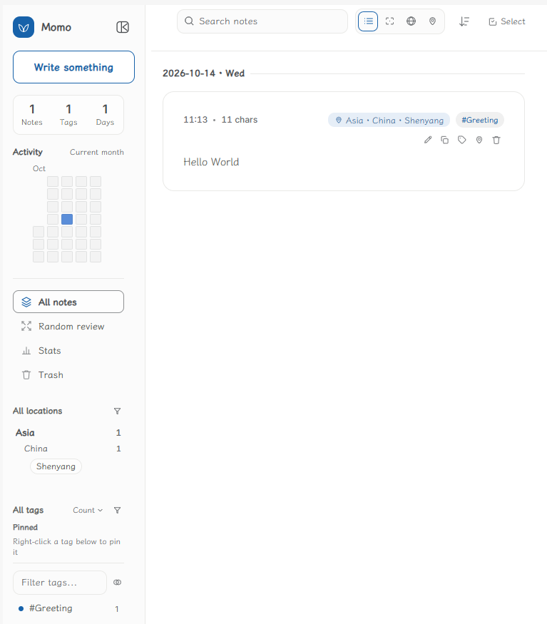
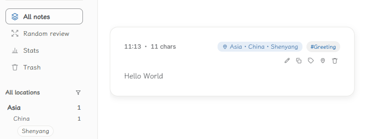
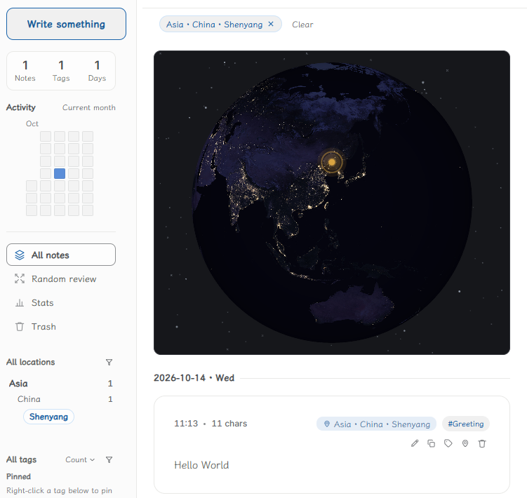
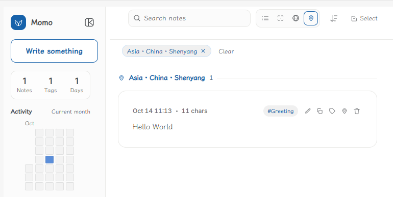
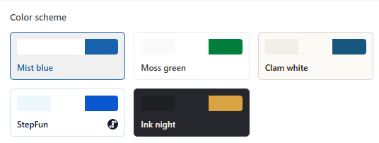

# Momo

[English](README.md) | [日本語](README.ja.md)

**Momo是一个卡片笔记插件。**

它替你管理文件名、标题、存放和格式，只留下记录本身：用标签和地点收纳每一条笔记，用不同的视图和回顾方式，让你用最舒服的姿势，和过去的自己重逢。

它的理念只有一句话：

> **保护你的注意力，进而保护你的情绪，把你自己放在杠杆最大的地方。**

当你在Momo里漫步，你是在和成百上千、成千上万个过去的声音交谈。在Momo，你不会孤独。你记下的每一条笔记，都是从过去的自己、从那些陪你
走过一段路的人和事那里借来的；也是送给未来的自己、和某个可能读到它的别人的礼物。

Momo从诞生的第一天起，就在替你做减法：

- **不再管理文件名、标题、存储和格式。** 发布框里写几个字，回车，就是一条笔记。文件该
  叫什么、存在哪儿、长什么样，Momo自己管
- **用标签和地点标记笔记。** `#标签` 和「北京」这样的小记号，就是全部的整理工作
- **随机回顾，是和过去的自己携手漫步。** 不刻意安排，只是在一个安静的下午，让一条旧笔记轻轻落在你面前
- **各种视图，让你以最舒服的方式阅读。** 列表、焦点、星球、地点——想怎么看，就怎么看

## 它的样子

- **列表视图**：所有笔记像卡片一样铺开，扫读、筛选、多选整理，都在这一屏。

- **焦点视图**：一次只面对一条笔记，上下卡片虚成背景，安安静静地读

  

- **星球视图**：记过的地点落在一颗缓缓旋转的地球上，点一个光点，就是那个地方写下的字

  

- **地点视图**：按 大洲 → 国家 → 地点 收成一棵树，点哪层看哪层

  

- **丰富的配色方案**：从雾蓝、苔绿到墨夜，挑一个顺眼的

  

## 常见问题

**我的数据存在哪儿？**
全部在你自己的笔记库里，就是一篇篇普通的笔记文件，用 Obsidian 本身就能打开、编辑、同步。插件只另外记一本小账（回收站里有哪些、你的界面偏好），仅此而已。

**卸载插件会丢东西吗？**
不会。你的笔记一个文件都不会被动过。

## 许可证

GNU Affero 通用公共许可证 v3.0 或更高版本 —— 见 [LICENSE](LICENSE)。
Copyright (C) 2026 iamxiaobing47。
